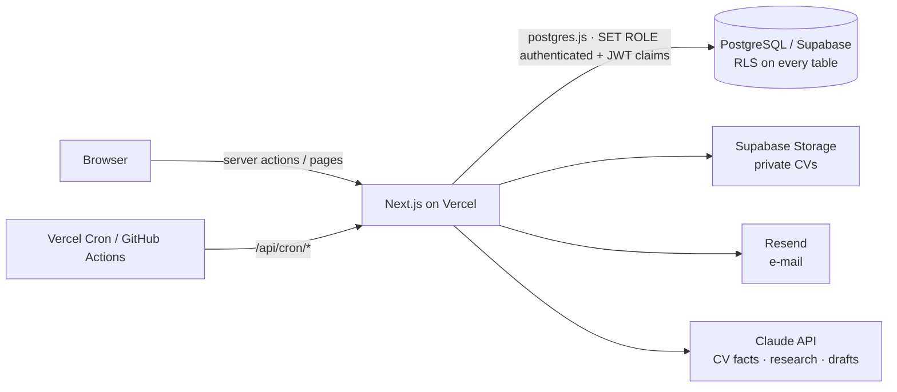

# 180DC Hub

Internal platform for **180 Degrees Consulting Barcelona**: recruitment (HR) and client outreach in one place,
with the analytics to make both fair and measurable. Built with Next.js, PostgreSQL (Supabase) and Vercel.

> The repository ships with **fictional demo data only** (people, organisations and e-mail domains under
> `example.com/.org/.net`). Never load real personal data into a demo deployment.

## What it does

**Recruitment**
- Public application form with CV upload (PDF check, bot protection, consent record) and automatic confirmation e-mail
- Pipeline board and table per recruitment cycle; every stage change goes through one database function that checks the
  allowed transitions, requires a reason for rejections and offers, and writes the history
- **Blind screening**: reviewers see an alias (e.g. `C-7F3A`), not name or university; they see colleagues' scores only after
  submitting their own (no anchoring)
- **Reviewer assignment as an integer linear program** (HiGHS): every application gets enough reviewers, nobody reviews a
  declared conflict, capacity limits hold, at least one senior reviewer, and the maximum relative load is minimised
- **Score calibration**: harsh and lenient graders are corrected with a two-way random-effects model
  (`score = μ + θ_candidate + β_reviewer + ε`), with Krippendorff's α as the reliability check of the rubric
- Interviews, status e-mails with approval step, CV fact extraction with Claude (LinkedIn, languages, nationality), Excel export

**Client outreach**
- Lead pipeline with one owner and one next step per lead, overdue and stale-lead alerts
- Organisations de-duplicated by domain and fuzzy name matching; Excel/CSV import with a review step
  (Spanish and Catalan headers, repeated rows, opt-outs)
- Bulk first e-mails: personalised, throttled per sender, **A/B-tested with Thompson sampling**, automatic follow-ups that
  stop when the lead replies
- **Bayesian A/B analysis** with an expected-loss stopping rule; **lead scoring** from an editable ideal client profile plus
  win rates learned from history (mature-cohort estimate, empirical-Bayes shrinkage, isotonic fit bands)
- Forecast of signed projects against the number of consulting teams recruitment will staff
- AI lead research (web search with sources; a person accepts every suggestion)
- Unsubscribe page and RFC 8058 one-click unsubscribe; one suppression list checked before every e-mail

**Admin & privacy**
- Roles enforced by **PostgreSQL row-level security**, not only by the UI
- GDPR: automatic anonymisation after the retention period, data export per person (Art. 15), erasure (Art. 17),
  append-only audit log
- System page: configuration checks, job history, e-mail delivery, AI spend

## Architecture in one picture



More in [docs/architecture.md](docs/architecture.md), the methods behind the numbers in [docs/analytics.md](docs/analytics.md).

## Run it locally

Requirements: Node.js 20.9+ and PostgreSQL 16 (plain Postgres is enough - a small shim provides the Supabase roles).

```bash
npm install
```

```bash
cp .env.example .env.local
```

Point `DATABASE_URL` in `.env.local` at an empty database, then create the schema and load the demo data:

```bash
npm run db:reset
```

```bash
npm run dev
```

Open http://localhost:3000 and sign in as one of the demo personas (HR, interviewer, Client Relations, admin, member).

| Command | What it does |
| --- | --- |
| `npm run db:migrate` | apply new migrations in `supabase/migrations` |
| `npm run db:reset` | drop, migrate and seed (refuses non-local databases) |
| `npm run db:seed:generate` | regenerate `supabase/seed.sql` from `scripts/seed` |
| `npm test` | unit tests (analytics, import, scoring, templates) |
| `npm run test:db` | row-level security and database rules, run as each role |
| `npm run test:e2e` | Playwright: application form, role guards, prospect import |

## Deploy

Vercel for the app, Supabase (EU region) for database, auth and storage - step by step in
[docs/deployment.md](docs/deployment.md). Privacy measures are summarised in [docs/privacy.md](docs/privacy.md),
design decisions in [docs/decisions.md](docs/decisions.md).
